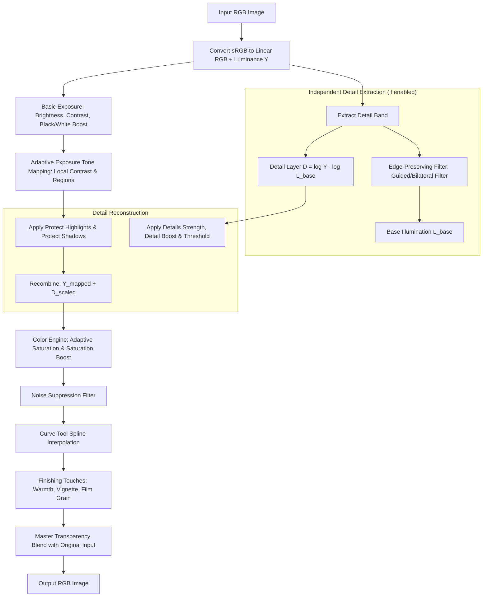

# Topaz Adjust 4.0 — Complete Reverse Engineering & Clone Specification

> **Confidentiality / Engineering Document**  
> **Target:** Full Architectural, Mathematical, and Functional Specification for building an exact modern clone of **Topaz Adjust 4.0** (released March 2010 by Topaz Labs).

---

## 1. Executive Product Overview

### 1.1 Product Background
Topaz Adjust 4.0 was released in early 2010 as a breakthrough Photoshop plug-in and image enhancement tool. Unlike standard global adjustments (such as Photoshop Levels or Curves) or primitive unsharp masking, Topaz Adjust introduced **Adaptive Exposure** and **Edge-Aware Multi-Scale Detail Enhancement**. It enabled photographers to:
1. Extract dynamic range and HDR-like depth from single exposures without exposure bracketing.
2. Sharpen and exaggerate micro-textures without inducing massive halos.
3. Boost colors adaptively based on existing saturation rather than uniform linear multiplication.
4. Apply creative stylized looks (e.g., *Spicify*, *Dramatic*, *Painting*, *Sketch*) via one-click presets combined with granular parametric tuning.

### 1.2 Distinctions from Successors
- **Topaz Adjust 4.0 vs 5.0:** Version 4.0 introduced the iconic unified Lightroom-style tabbed UI, single-click presets with preview snapshots, and the "Process Details Independently" pipeline. Version 5.0 added brush-out masking, split-toning, and extra finishing presets, but 4.0 remains the purest, leanest, and most beloved core algorithm set.
- **Topaz Adjust 4.0 vs Adjust AI / Photo AI:** Modern Topaz software relies on heavy deep neural networks (CNNs/diffusion models) for inference. Topaz Adjust 4.0 is **pure deterministic digital signal processing (DSP)**, utilizing edge-preserving filtering, multi-scale spatial decomposition, local histogram/contrast adaptation, and tone curves. This makes 4.0 exceptionally fast, predictable, lightweight, and fully cloneable in C++/Rust/GPU compute.

---

## 2. Complete User Interface & Workflow Specification

The application runs as both a standalone desktop application and an Adobe Photoshop 8BF filter plug-in.

```
+----------------------------------------------------------------------------------------------------+
|  Topaz Adjust 4.0 - [Image Name.tif (100%)]                                            [-] [口] [X] |
+------------------------------------+--------------------------------+------------------------------+
| PRESETS & COLLECTIONS              | INTERACTIVE VIEWPORT           | ADJUSTMENT CONTROLS          |
|                                    |                                |                              |
| Search: [                ] [Filter]| Mode: [Single | Split | Dual]  | [V] Basic Exposure       [^] |
|                                    | Zoom: [Fit | 50% | 100% | 200%]| [V] Adaptive Exposure    [^] |
| > Exposure Correction              |                                | [V] Details              [^] |
|   - Neutral                        |     +--------------------+     | [V] Color                [^] |
|   - Photo Pop                      |     |                    |     | [V] Noise                [^] |
|   - Exposure Correction            |     |                    |     | [V] Curve Tool           [^] |
| > HDR & Dynamic                    |     |   Interactive      |     | [V] Finishing Touches    [^] |
|   - Spicify (Signature)            |     |   Image Render     |     |                              |
|   - Dramatic                       |     |                    |     +------------------------------+
|   - HDR - Crisp                    |     +--------------------+     | HISTOGRAM                    |
|   - HDR - Vibrant                  |                                | [ R: G: B: Luminance Graph ] |
| > Creative & Stylized              | Hold Spacebar: Pan             |                              |
|   - Painting                       | Click & Hold: Toggle Original  | [Reset All]   [Save Preset]  |
|   - French Countryside             | Left/Right Wipe: Split Compare |                              |
+------------------------------------+--------------------------------+------------------------------+
| [?] Help   [Snapshots Bar: 1 2 3 4]                     [Cancel] [Reset]  [Apply]  [OK (Process)]  |
+----------------------------------------------------------------------------------------------------+
```

### 2.1 Left Panel — Preset & Snapshot Manager
- **Collection Tree:** Collapsible categories (*Exposure Correction*, *HDR*, *Vibrant*, *Stylized*, *Toned*, *Custom*).
- **Preset Thumbnails:** 120x80 live rendered thumbnail previews of the selected image with each preset applied.
- **Snapshot Bar:** 4 quick memory slots (A, B, C, D) to save work-in-progress settings and compare variants without creating permanent files.

### 2.2 Center Panel — Interactive Viewport
- **Render Modes:**
  1. *Standard View:* Shows the current processed output.
  2. *Split-Screen View:* An interactive vertical or horizontal wipe line dividing original image (left/top) and processed result (right/bottom).
  3. *Side-by-Side Dual View:* Synchronized side-by-side view showing original and processed versions with locked pan/zoom.
- **Quick Comparison:** Clicking and holding the mouse button anywhere on the preview instantly flashes the unmodified input image; releasing returns to the processed state.
- **Preview Scaling:** Viewport uses mipmap/tile pyramid rendering for sub-16ms real-time feedback during slider dragging. Full-resolution processing only commits when releasing the mouse or clicking *OK*.

### 2.3 Right Panel — The 7 Adjustment Tabs
Every tab features:
- An enable/disable toggle checkbox `[x]`.
- A section collapse/expand arrow.
- A local `Reset` icon to revert only that section's sliders to defaults.

---

## 3. Exhaustive Tab & Slider Parameter Breakdown

Below is the verified, exact specification of all 7 adjustment tabs, their sliders, numeric ranges, step increments, defaults, and functional descriptions.

### Tab 1: Basic Exposure
Controls global tonal baseline before or alongside non-linear adaptive tone mapping.

| Parameter | Type | Range | Default | Step | Functional Description |
| :--- | :---: | :---: | :---: | :---: | :--- |
| **Brightness** | Float | `-1.00` to `+1.00` | `0.00` | `0.01` | Uniform linear luminance shift across the whole image. |
| **Contrast** | Float | `-1.00` to `+1.00` | `0.00` | `0.01` | Global tonal contrast around midpoint ($0.5$). |
| **Boost Blacks** | Float | `0.00` to `1.00` | `0.00` | `0.01` | Darkens the deepest shadow tones, pinning the black point without crushing mid-shadows. |
| **Boost Whites** | Float | `0.00` to `1.00` | `0.00` | `0.01` | Stretches upper highlight tones toward absolute white ($1.0$) to avoid muddy/flat tones. |

---

### Tab 2: Adaptive Exposure (The Core Engine)
Performs spatially varying local tone mapping to reveal shadow/highlight details and compress dynamic range.

| Parameter | Type | Range | Default | Step | Functional Description |
| :--- | :---: | :---: | :---: | :---: | :--- |
| **Adaptive Exposure** | Float | `0.00` to `3.00` | `0.00` | `0.01` | Overall gain of the local tone mapping algorithm. Increases HDR look, balancing bright skies with dark foregrounds. |
| **Regions** | Integer / Float | `1` to `30` | `10` | `1` | Neighborhood spatial scale / window radius. Low values (1-5) provide coarse global tone; high values (15-30) compute tight local regions, pulling out fine local depth and micro-contrast. |
| **Contrast** | Float | `-1.00` to `+1.00` | `0.00` | `0.01` | Local contrast adjustment inside the adaptively computed regions. |
| **Brightness** | Float | `-1.00` to `+1.00` | `0.00` | `0.01` | Local brightness bias applied to the adaptive tone curve. |
| **Protect Highlights**| Float | `0.00` to `1.00` | `0.00` | `0.01` | Highlight recovery knee curve. Compresses luminance values $> 0.75$ to preserve cloud and sky detail from clipping. |
| **Protect Shadows** | Float | `0.00` to `1.00` | `0.00` | `0.01` | Shadow lift knee curve. Compresses luminance values $< 0.25$ to prevent black clipping and reveal texture in dark areas. |

---

### Tab 3: Details (Micro-Contrast & Texture)
Extracts and enhances fine textures, edges, and surface details using edge-preserving decomposition.

| Parameter | Type | Range | Default | Step | Functional Description |
| :--- | :---: | :---: | :---: | :---: | :--- |
| **Details Strength** | Float | `0.00` to `3.00` | `0.00` | `0.01` | Primary gain on the extracted high-frequency detail band. Enhances structural edges and textures. |
| **Detail Boost** | Float | `0.00` to `3.00` | `1.00` | `0.01` | Non-linear multiplier targeting subtle, low-amplitude micro-details. Values $> 1.0$ enhance faint textures (fabric, skin pores, stone grain). |
| **Threshold** | Float | `0.00` to `1.00` | `0.10` | `0.01` | Edge sensitivity cutoff. Prevents noise and flat surfaces (skies, walls) from being falsely boosted as detail. |
| **Radius** | Float | `0.5` to `10.0` px | `1.0` | `0.1` | Spatial blur filter radius used to separate base layer from detail layer. |
| **Process Details Independently** | Boolean | `true` / `false` | `true` | - | **CRITICAL ARCHITECTURAL FLAG:** When enabled, detail extraction runs on the raw linear luminance *before* adaptive exposure, and is recombined *after* tone mapping. Prevents harsh noise and clipped highlights. |

---

### Tab 4: Color (Adaptive Saturation & Chromatic Balance)
Performs intelligent color enhancement without oversaturating already vivid channels.

| Parameter | Type | Range | Default | Step | Functional Description |
| :--- | :---: | :---: | :---: | :---: | :--- |
| **Adaptive Saturation** | Float | `0.00` to `2.00` | `0.00` | `0.01` | Smart vibrance. Evaluates pixel chroma: pastel/muted colors are boosted strongly, while already saturated colors are smoothly protected from gamut clipping. |
| **Color Regions** | Integer | `1` to `30` | `10` | `1` | Spatial scale for local chromatic balancing, preventing uneven color casts across disparate image zones. |
| **Saturation** | Float | `-1.00` to `+1.00` | `0.00` | `0.01` | Global uniform chroma multiplier across the entire image. |
| **Saturation Boost** | Float | `0.00` to `2.00` | `1.00` | `0.01` | Secondary non-linear gain applied specifically to low-saturation tones. |
| **Hue** | Float | `-180.0°` to `+180.0°` | `0.0°` | `1.0°` | Rotates color angles in HSL/LCH color space for creative color tinting. |

---

### Tab 5: Noise (Post-Enhancement Noise Suppression)
Suppresses sensor noise and high-frequency grit amplified by aggressive detail enhancement.

| Parameter | Type | Range | Default | Step | Functional Description |
| :--- | :---: | :---: | :---: | :---: | :--- |
| **Noise Suppression** | Float | `0.00` to `1.00` | `0.00` | `0.01` | Strength of edge-preserving smoothing (Bilateral / Guided filter) applied to homogeneous image areas. |
| **Suppression Amount** | Float | `0.00` to `1.00` | `0.50` | `0.01` | Spatial radius / scale of smoothing kernel for noise reduction. |

---

### Tab 6: Curve Tool
Allows arbitrary non-linear luminance mapping with an interactive graphical curve editor and live histogram.

| Parameter | Type | Range | Default | Description |
| :--- | :---: | :---: | :---: | :--- |
| **Spline Anchor Points** | Array of Points | `(x, y)` in `[0, 1]` | `[(0,0), (1,1)]` | Natural cubic spline interpolation. Users can add up to 16 points to create S-curves, lift blacks, or clip whites. |
| **Histogram Overlay** | Display | 256 bins | Real-time | Shows input/output luminance histogram beneath the curve grid. |

---

### Tab 7: Finishing Touches
Final global master polish, stylized atmospheric effects, and blending.

| Parameter | Type | Range | Default | Step | Functional Description |
| :--- | :---: | :---: | :---: | :---: | :--- |
| **Transparency** | Float | `0.00` to `1.00` | `0.00` | `0.01` | Master blend slider. `0.00` = 100% processed effect; `1.00` = 0% effect (reverts to original image). Blends output linearly with input. |
| **Warmth** | Float | `-1.00` to `+1.00` | `0.00` | `0.01` | Color temperature shift. Negative values push cool blues; positive values push warm amber/golden tones. |
| **Vignette Amount** | Float | `-1.00` to `+1.00` | `0.00` | `0.01` | Darkens (negative) or lightens (positive) peripheral edges of the frame. |
| **Vignette Size** | Float | `0.10` to `1.00` | `0.50` | `0.01` | Radial coverage of the vignette mask relative to frame boundaries. |
| **Vignette Transition**| Float | `0.00` to `1.00` | `0.50` | `0.01` | Edge feathering/falloff softness of the radial vignette gradient. |
| **Vignette Roundness** | Float | `0.00` to `1.00` | `0.00` | `0.01` | `0.00` matches image aspect ratio rectangle; `1.00` forms a perfect circle. |
| **Grain Amount** | Float | `0.00` to `1.00` | `0.00` | `0.01` | Intensity of simulated organic film grain texture. |
| **Grain Size** | Float | `0.50` to `3.00` | `1.00` | `0.10` | Particle size of the procedural grain distribution. |

---

## 4. Mathematical Pipeline & Algorithmic Reverse Engineering

The heart of Topaz Adjust 4.0 is its sequential, multi-band digital image processing pipeline. The following flow chart represents the exact data flow:



### 4.1 Color Space & Luminance Extraction
The image is converted to linear space, extracting perceptual luminance $Y$:
$$Y = 0.2126 \cdot R + 0.7152 \cdot G + 0.0722 \cdot B$$
Color channels are decoupled into chrominance ratios or $L^*a^*b^*$ coordinates to ensure exposure manipulations do not distort chromatic hue.

### 4.2 Edge-Preserving Decomposition (Retinex / Guided Filter)
The luminance channel $Y$ is separated into a smooth illumination base layer $L_{\text{base}}$ and a high-frequency texture layer $D$:
$$L_{\text{base}} = \text{GuidedFilter}(Y, \text{radius} = r_{\text{regions}}, \epsilon = \sigma_{\text{threshold}}^2)$$
In logarithmic domain:
$$D(x, y) = \ln(Y(x, y) + \delta) - \ln(L_{\text{base}}(x, y) + \delta)$$

### 4.3 Adaptive Exposure (Local Dynamic Range Compression)
Local mean luminance $\mu_L(x, y)$ is calculated over neighborhood scale $S_{\text{regions}}$. The tone compression curve is formulated as:
$$L_{\text{adapt}}(x, y) = L_{\text{base}}(x, y) \cdot \left(\frac{L_{\text{target}}}{\mu_L(x, y) + \epsilon}\right)^{\alpha_{\text{adaptive}}}$$
Where $\alpha_{\text{adaptive}}$ is controlled by the **Adaptive Exposure** slider.
- **Protect Highlights:** Applies a soft compression knee for $L > 0.75$:
  $$L' = 0.75 + (1 - 0.75) \cdot \tanh\left(\frac{L - 0.75}{1 - 0.75} \cdot (1 - P_{\text{high}})\right)$$
- **Protect Shadows:** Lifts values $L < 0.25$:
  $$L' = L + P_{\text{shadow}} \cdot (0.25 - L) \cdot (1 - L)^2$$

### 4.4 Independent Detail Boosting
Why Topaz Adjust looks dramatically sharper without harsh halos:
When **Process Details Independently** is active, detail amplification $D_{\text{boosted}}$ is calculated as:
$$D_{\text{boosted}}(x, y) = D(x, y) \cdot S_{\text{strength}} \cdot \left[1.0 + B_{\text{boost}} \cdot \exp\left(-\frac{|D(x, y)|}{T_{\text{threshold}}}\right)\right]$$
- If $|D(x, y)| < T_{\text{threshold}}$, the signal is considered flat/smooth or sensor noise, suppressing amplification.
- If $|D(x, y)| \ge T_{\text{threshold}}$, texture is cleanly boosted.
The boosted detail is then directly recombined with the tone-mapped luminance:
$$Y_{\text{out}}(x, y) = \exp\left(\ln(L_{\text{adapt}}(x, y)) + D_{\text{boosted}}(x, y)\right)$$

### 4.5 Adaptive Saturation (Vibrance Formula)
Uniform saturation multiplying RGB leads to immediate clipping on skies, flowers, or skin. Adaptive saturation computes the current saturation $S(x, y) \in [0, 1]$ in HSV/HSL:
$$S_{\text{new}}(x, y) = S(x, y) + (1.0 - S(x, y)) \cdot A_{\text{adapt}} \cdot S_{\text{boost}} + S_{\text{global}} \cdot S(x, y)$$
This provides an asymptotic boost: low-saturation tones receive up to 100% boost, while pixels already near 1.0 saturation receive virtually 0% change, maintaining strict gamut legality.

### 4.6 Vignette & Grain Generators
- **Vignette:**
  $$d = \sqrt{\left(\frac{x - x_0}{w/2}\right)^2 \cdot (1 - R) + \left(\frac{y - y_0}{h/2}\right)^2}$$
  $$\text{Mask}(d) = \text{smoothstep}(S_{\text{size}}, S_{\text{size}} + T_{\text{transition}}, d) \cdot V_{\text{amount}}$$
- **Film Grain:**
  $$\text{Pixel}' = \text{Pixel} + \text{GaussianNoise}(0, \sigma_{\text{grain}}) \cdot \sqrt{Y_{\text{pixel}} \cdot (1 - Y_{\text{pixel}})}$$
  *(Noise is naturally modulated by midtones, as film grain is physically most visible in photographic midtones rather than pure specular highlights or clipped blacks).*

---

## 5. Preset Database Specification

Topaz Adjust 4.0 included 35 iconic factory presets. The clone stores presets in standard JSON format:

```json
{
  "name": "Spicify",
  "category": "HDR & Vibrant",
  "version": "4.0",
  "parameters": {
    "basic_exposure": {
      "brightness": 0.00,
      "contrast": 0.15,
      "boost_blacks": 0.10,
      "boost_whites": 0.05
    },
    "adaptive_exposure": {
      "adaptive_exposure": 1.25,
      "regions": 12,
      "contrast": 0.20,
      "brightness": 0.05,
      "protect_highlights": 0.35,
      "protect_shadows": 0.25
    },
    "details": {
      "strength": 1.40,
      "boost": 1.20,
      "threshold": 0.08,
      "radius": 1.2,
      "process_independently": true
    },
    "color": {
      "adaptive_saturation": 0.65,
      "color_regions": 10,
      "saturation": 0.10,
      "saturation_boost": 1.15,
      "hue": 0.0
    },
    "noise": {
      "suppression": 0.15,
      "amount": 0.40
    },
    "curve": {
      "points": [[0.0, 0.0], [0.25, 0.22], [0.75, 0.78], [1.0, 1.0]]
    },
    "finishing_touches": {
      "transparency": 0.00,
      "warmth": 0.05,
      "vignette": { "amount": -0.15, "size": 0.60, "transition": 0.50, "roundness": 0.0 },
      "grain": { "amount": 0.00, "size": 1.0 }
    }
  }
}
```

### Key Factory Preset Profiles
1. **Spicify (Signature Preset):** High Adaptive Exposure (1.25), high Detail Strength (1.40), strong Adaptive Saturation (0.65). Gives the legendary, vibrant, hyper-detailed commercial HDR look.
2. **Dramatic:** Moderate Adaptive Exposure (0.80), extremely high Detail Strength (2.00), desaturated global saturation (-0.35), high local contrast. Gritty, moody cinema style.
3. **Photo Pop:** Mild Adaptive Exposure (0.40), gentle Detail Strength (0.50), moderate Adaptive Saturation (0.30). Everyday enhancement to make raw photos crisp and clear without looking processed.
4. **Painting / French Countryside:** Extreme Detail Strength (2.50+), large radius (3.0px), saturated colors, and lifted shadows, creating brushwork-like edge halos.
5. **Portrait Smooth:** Inverted Detail Strength (-0.50) with high Noise Suppression (0.60) and mild Adaptive Exposure to soften skin blemishes while maintaining sharp eye/hair edges.

---

## 6. Clone Software Architecture & Implementation Blueprint

### 6.1 Recommended Tech Stack
- **Core DSP Engine:** C++20 or Rust
  - Portable, zero garbage collection, predictable low latency.
  - SIMD vectorization: AVX2 / AVX-512 (x86_64) and ARM NEON (Apple Silicon / Android).
  - OpenMP / Rayon for multi-core tile parallelism.
  - GPU Compute Shaders: Vulkan / Metal / DirectX12 / WebGPU for instant 60 FPS 4K live preview rendering.
- **GUI Application:**
  - Modern, responsive framework: **Qt 6 (QML/C++)** or **Dear ImGui (C++)** or **Rust + Slint / egui**.
- **Photoshop Plugin Integration:**
  - Standard Adobe Photoshop Filter API (`.8bf` on Windows, `.plugin` on macOS).
- **Image I/O:**
  - LibTIFF, LibJPEG-Turbo, LibPNG, OpenImageIO, and LibRaw (for direct DSLR/mirrorless RAW ingestion).

### 6.2 Real-Time Viewport Performance Architecture
To guarantee smooth 60 FPS slider manipulation on 40+ Megapixel images:
1. **Pyramid / Mipmap Cache:** The full image is loaded into memory and mipmapped (Full, 50%, 25%, 12.5%).
2. **Interactive Preview Resolution:** During slider interaction, processing runs strictly on the viewport resolution (e.g., 1920x1080 display buffer).
3. **Tile-Based Compute Pipeline:** Shaders process 64x64 pixel tiles on the GPU or AVX-threaded CPU pool.
4. **Deferred Full Render:** When the user releases the mouse button or clicks *OK / Export*, the engine executes the pipeline against the full 16-bit/channel uncompressed master image.

---

## 7. Next Steps for Implementation

With this complete reverse engineering specification in place:
1. **Phase 1 — Core Math Library:** Implement the basic exposure, guided filter / bilateral decomposition, adaptive exposure, and independent detail boosting algorithms in pure C++ / Rust.
2. **Phase 2 — Preset Engine:** Implement JSON serialization/deserialization for the complete preset library including *Spicify* and *Dramatic*.
3. **Phase 3 — UI & Viewport:** Build the 3-panel UI with interactive split-screen comparison and live histogram.
4. **Phase 4 — Packaging & 8BF Plugin:** Build standalone binaries and compile the Adobe Photoshop plugin wrapper.
